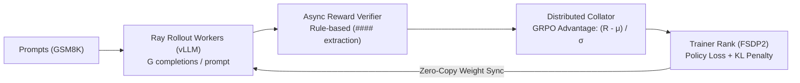
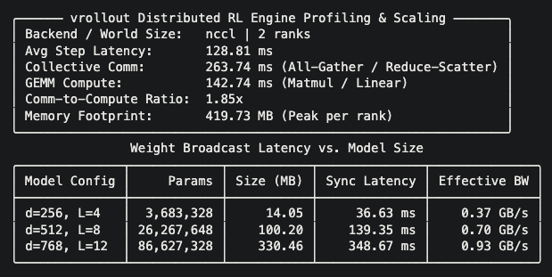
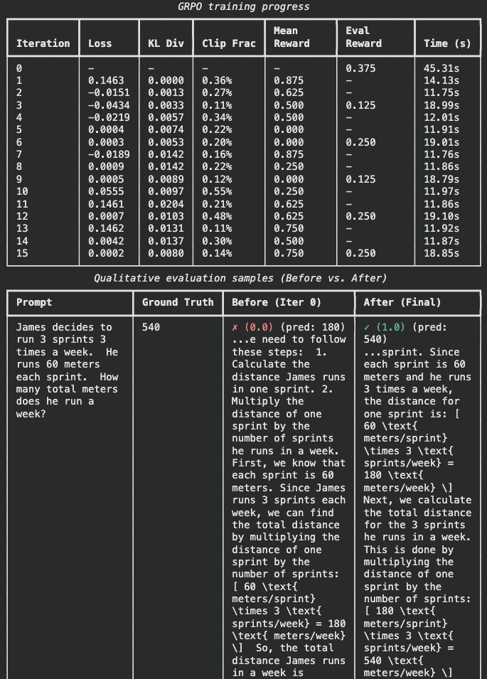

# vRollout: Distributed RL post-training engine

[](https://www.python.org/downloads/)
[](#testing)
[](LICENSE)

A distributed reinforcement learning (RL) rollout generation and training pipeline designed to decouple high-throughput autoregressive inference from policy training.

This repository is an educational reference implementation to study and benchmark inference-training topologies used in LLM post-training.

---

## Overview

Post-training foundation models with reinforcement learning (e.g. PPO, GRPO) introduces severe tension between memory-bound autoregressive token generation and compute-bound model training. Running both within a monolithic loop creates CUDA memory fragmentation and GPU idle bubbles while trainers wait for completion tokens to be available.

`vRollout` resolves this tension by decoupling token generation, reward evaluation, and policy updates into isolated asynchronous actors communicating across bounded queues and Ray's Plasma object store for zero-copy weight synchronization.



---

## Getting started

Prerequisites: Python 3.12+ and [uv](https://github.com/astral-sh/uv).

```bash
# Clone repository and install dependencies
git clone https://github.com/firnlabs/vrollout.git
cd vrollout
uv sync
```

### 30-second quickstart (local / CPU)

Run a distributed 2-rank GRPO training loop on GSM8K locally without requiring a GPU cluster:

```bash
# Optional: set UV_LINK_MODE=copy if your environment uses mounted scratch volumes (e.g. Kaggle Notebooks)
uv run torchrun --standalone --nproc_per_node=2 --local-addr 127.0.0.1 \
  -m vrollout.train \
  --backend mock \
  --dataset gsm8k \
  --group-size 4 \
  --num-iterations 3 \
  --eval-every 1
```

### GPU cluster training (vLLM backend)

Train an open-weight policy on a GPU cluster using Ray rollout actors backed by vLLM:

```bash
uv run torchrun --standalone --nproc_per_node=4 \
  -m vrollout.train \
  --backend vllm \
  --model-name Qwen/Qwen2.5-0.5B-Instruct \
  --dataset gsm8k \
  --group-size 8 \
  --num-rollout-workers 2 \
  --gpus-per-worker 1.0 \
  --wandb
```

### Running the distributed engine benchmark

The following benchmark script profiles PyTorch FSDP2 model sharding, distributed training iterations, and parameter weight broadcasting across ranks (tested on CPU via `gloo` and GPU via `nccl`):

```bash
uv run torchrun --standalone --nproc_per_node=2 --local-addr 127.0.0.1 \
  benchmarks/run_engine_benchmark.py
```

To view all benchmark configuration options (such as `--with-stack`, `--warmup-steps`, and `--trace-dir`):

```bash
uv run python benchmarks/run_engine_benchmark.py --help
```

#### Sample benchmark

Below are the benchmarking results from 2x T4 GPU accelerators in Kaggle Notebooks:



---

## GSM8K results

The screenshot below shows the training iterations table of a distributed GRPO post-training on `Qwen/Qwen2.5-0.5B-Instruct` on an NVIDIA L4 GPU, alongside the deterministic before-and-after qualitative evaluation.



The full results can be found in the [GSM8K Training Report](docs/reports/gsm8k-training-report.md).

---

## Directory structure

```text
.
├── benchmarks/
│   ├── run_engine_benchmark.py         # Engine profiling & communication scaling
│   └── run_gpu_benchmark.py            # GPU capability, PCIe/HBM bandwidth & GEMM profiling
├── docs/
│   ├── assets/                         # Documentation screenshots & visual assets
│   └── reports/                        # Empirical evaluation & training reports
├── src/vrollout/
│   ├── async_queue.py                  # Asynchronous queue for reward scoring
│   ├── buffer.py                       # Distributed rollout buffer and batch collation
│   ├── collate.py                      # Sequence batch padding and collation
│   ├── datasets.py                     # GSM8K and synthetic dataset loaders
│   ├── engine.py                       # Distributed RL engine orchestrator
│   ├── gae.py                          # Fused Triton GAE kernel with PyTorch reference
│   ├── generation.py                   # Distributed token generation using Ray
│   ├── grpo.py                         # GRPO loss and advantage calculation
│   ├── pipeline.py                     # Rollout generation and scoring pipeline
│   ├── sync.py                         # Weight broadcasting back to rollout actors
│   ├── train.py                        # Distributed GRPO CLI runner
│   ├── verifiers.py                    # Rule-based math answer verifiers (GSM8K)
│   └── vllm_engine.py                  # vLLM async worker integration
├── tests/
│   ├── unit/                           # Unit tests
│   └── integration/                    # Integration tests
└── pyproject.toml                      # uv-based Python project configuration
```

---

## Testing

Run the complete test suite:

```bash
uv run pytest
```

---

## Contributing

Contributions, feedback, and bug reports are welcome. To contribute:

1. Fork the repository and create a feature branch (e.g. `git checkout -b feat/my-feature`).
2. Verify all tests pass and linting succeeds (`uv run pytest && uv run ruff check`).
3. Submit a pull request describing the rationale, changes made, and invariants preserved.

---

## License

This project is licensed under the Apache License 2.0 - see the [LICENSE](LICENSE) file for details.
