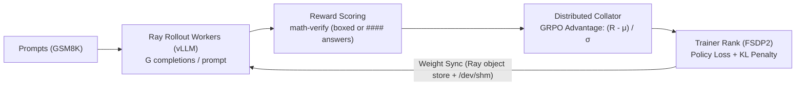
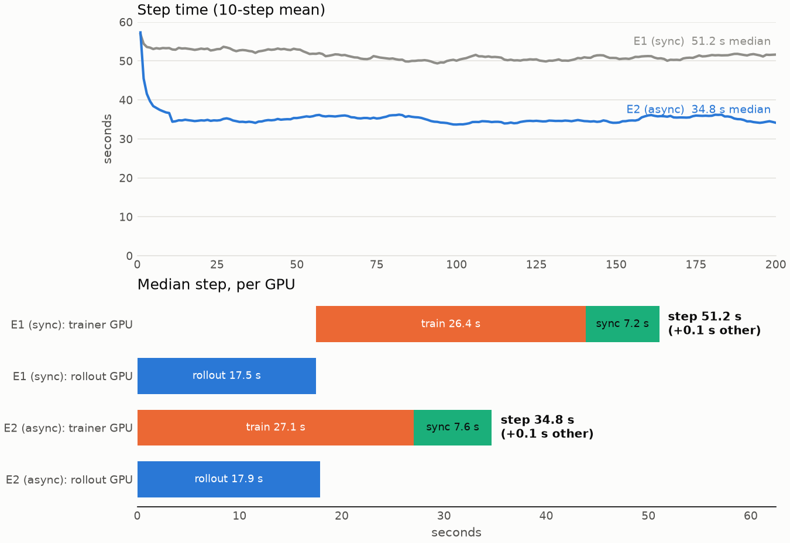
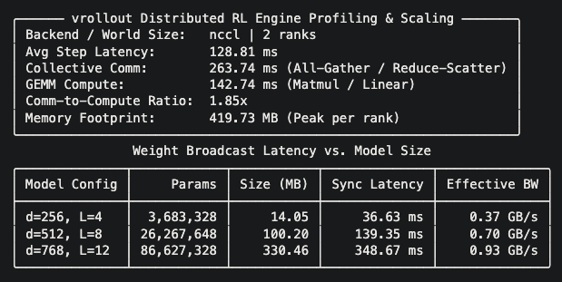

# vRollout: Distributed RL post-training engine

[](https://www.python.org/downloads/)
[](#testing)
[](LICENSE)

A distributed reinforcement learning (RL) rollout generation and training pipeline designed to decouple high-throughput autoregressive inference from policy training.

This repository is an educational reference implementation to study and benchmark inference-training topologies used in LLM post-training.

On GSM8K, asynchronous rollouts cut GRPO step time by 32% with no measurable accuracy cost (Qwen2.5-0.5B-Instruct, 2x A40; [results](#gsm8k-results)).

---

## Overview

Post-training language models with reinforcement learning (e.g. PPO, GRPO) alternates two very different workloads: memory-bound autoregressive generation and compute-bound training. Run one after the other, each GPU sits idle while the other works.

`vRollout` runs generation on Ray rollout workers backed by vLLM and training on separate GPUs with FSDP2. Rewards are scored as completions arrive. With `--async-rollouts`, the next batch generates while the current one trains. After each policy update, rank 0 gathers the full FSDP2 parameters and sends them to the rollout workers through Ray's object store; each worker stages them as safetensors in shared memory (`/dev/shm`) and reloads them in place inside vLLM.



---

## GSM8K results

`Qwen/Qwen2.5-0.5B-Instruct` was trained with GRPO for 200 steps on 6,400 GSM8K training problems (32 prompts × G = 8 per step, T = 1.0, LR = 1e-6), with 2x A40 GPUs (trainer and vLLM rollout worker on separate GPUs).
E1 is synchronous.
E2 is the same run with `--async-rollouts`, which generates the next batch while the current one trains.
Checkpoints were evaluated on all 1,319 test problems with greedy decoding and strict scoring.

| Model | Strict accuracy | Truncated | Median step | Step time, 200 steps |
| --- | --- | --- | --- | --- |
| E0 (untrained) | 0.488 | 5.1% | — | — |
| E1 (sync, step 200) | 0.527 | 4.3% | 51.2 s | 2.85 h |
| E2 (async, step 200) | 0.535 | 3.4% | 34.8 s | 1.95 h |

Truncated answers hit the 512-token limit.
Step time excludes evals and checkpoint saves.



Findings:

- In async mode, rollout (17.9 s) runs hidden behind training (27.1 s).
  The step is training plus the 7.6 s weight sync.
- Each batch is generated by weights one update older than the ones it trains, and E2 scored +0.8 points against E1 (95% CI −1.3 to +3.0), so async training had no measurable accuracy cost.
  Both runs beat the untrained model: E1 by +3.9 points (p = 0.0008) and E2 by +4.7 (p = 5.6 × 10⁻⁵).
  E0 matches the 49.6 reported for this model in the Qwen2.5 technical report.
- Repeating the greedy eval of the same model in a new vLLM engine flipped the verdict on 8–11% of problems, most likely because vLLM's kernels are not batch-invariant.
  Runs are therefore compared with paired evals on the full test set rather than single 500-problem evals.

Debugging:

- Earlier runs collapsed because rollouts were sampled at T = 0.8 while vLLM and the trainer both computed log-probs at T = 1.0, making training silently off-policy.
  PR #72 fixed the mismatch.

The setup, analysis and reproduction commands are in the [E0/E1 report](docs/reports/2026-11-06-e0-e1-grpo-gsm8k/e1-report.md) (sync GRPO) and the [E2 report](docs/reports/2026-11-18-e2-async-grpo-gsm8k/e2-report.md) (async GRPO, E2/E1 comparison).

Earlier runs are in [docs/reports/](docs/reports/).

---

## Getting started

Prerequisites: Python 3.12+ and [uv](https://github.com/astral-sh/uv).

```bash
# Clone repository and install dependencies
git clone https://github.com/firnlabs/vrollout.git
cd vrollout
uv sync
```

### Quickstart (CPU)

Run a distributed 2-rank GRPO training loop on GSM8K locally without requiring a GPU cluster:

```bash
# Optional: set UV_LINK_MODE=copy if your environment uses mounted scratch volumes (e.g. Kaggle Notebooks)
uv run torchrun --standalone --nproc_per_node=2 --local-addr 127.0.0.1 \
  -m vrollout.train \
  --backend mock \
  --dataset gsm8k \
  --group-size 4 \
  --num-iterations 3 \
  --eval-every 1
```

### GPU cluster training (vLLM backend)

Train an open-weight policy on a single GPU node using Ray rollout actors backed by vLLM. On a 4-GPU node, the command below trains on GPUs 0-1 and serves vLLM on GPUs 2-3:

```bash
uv run torchrun --standalone --nproc_per_node=2 \
  -m vrollout.train \
  --backend vllm \
  --model-name Qwen/Qwen2.5-0.5B-Instruct \
  --dataset gsm8k \
  --group-size 8 \
  --num-rollout-workers 2 \
  --gpus-per-worker 1.0 \
  --wandb
```

- **Async rollouts**: `--async-rollouts` generates the next batch while the current one trains, so each batch is trained one weight version stale; weights are still copied to vLLM after every step.
- **Sharding**: With more than one trainer rank, actor and reference models are sharded per transformer block with FSDP2, and the loss is normalized by the global token count so the update matches a single-process step. Pass `--fsdp` to shard on a single rank too.
- **GPU placement**: Trainer rank `r` uses the `r`-th visible GPU, and rollout workers get the GPUs left over. With none left, vLLM shares the trainers' GPUs, so lower `--gpu-memory-utilization` and use a fractional `--gpus-per-worker`.

Run `uv run python -m vrollout.train --help` for all options, including checkpointing and distributed timeouts.

### Experiment tracking with Weights & Biases

`vrollout` logs to [Weights & Biases](https://wandb.ai) from rank 0:

```bash
uv run torchrun --standalone --nproc_per_node=2 \
  -m vrollout.train \
  --backend vllm \
  --model-name Qwen/Qwen2.5-0.5B-Instruct \
  --dataset gsm8k \
  --group-size 8 \
  --num-rollout-workers 2 \
  --gpus-per-worker 1.0 \
  --wandb \
  --wandb-project vrollout \
  --wandb-run-name qwen0.5b-gsm8k-run1
```

- **Run naming**: Runs default to an informative identifier formatted as `{model}-{backend}-{dataset}-G{group_size}-{timestamp}` (e.g. `Qwen2.5-0.5B-Instruct-vllm-gsm8k-G8-20261027_154500`). Use `--wandb-run-name` to supply a custom name.
- **Offline / Local testing**: You can test without an account or internet access by setting `WANDB_MODE=offline`. Metrics will be logged locally to `wandb/` (ignored by git):

  ```bash
  WANDB_MODE=offline uv run torchrun --standalone --nproc_per_node=1 --local-addr 127.0.0.1 \
    -m vrollout.train --backend mock --wandb
  ```

- **Live dashboards & Colab**: Authenticate using `uv run wandb login` or export `WANDB_API_KEY="<key>"`. Tracked metrics include:
  - **Policy metrics**: `loss`, `kl`, `clip_fraction`, `reward_mean`, `eval_reward_mean`, `eval_accuracy_strict` (only answers marked with `\boxed{}`, `####` or a phrase such as "The answer is" count) and `eval_accuracy_lenient` (falls back to the last math expression in the completion), independent of `--strict-format`.
  - **Performance**: `step_time_s` per iteration, with rollout, training and weight-sync times.
  - **Hardware telemetry**: GPU memory allocation, GPU power draw, temperature, and compute utilization.
  - **Evaluation answers**: `eval_response_length_mean`, `eval_truncation_rate`, and an `eval_samples` table with every eval answer (prompt, extracted and raw ground truth, completion, extracted answer, reward, finish reason, length). Pass `--eval-output-dir <dir>` to also save them as `eval-step-<N>.jsonl`.

### Running the distributed engine benchmark

The following benchmark script profiles PyTorch FSDP2 model sharding, distributed training iterations, and parameter weight broadcasting across ranks (tested on CPU via `gloo` and GPU via `nccl`):

```bash
uv run torchrun --standalone --nproc_per_node=2 --local-addr 127.0.0.1 \
  benchmarks/run_engine_benchmark.py
```

To view all benchmark configuration options (such as `--with-stack`, `--warmup-steps`, and `--trace-dir`):

```bash
uv run python benchmarks/run_engine_benchmark.py --help
```

#### Sample benchmark

Below are the benchmarking results from 2x T4 GPU accelerators in Kaggle Notebooks:



---

## Directory structure

```text
.
├── benchmarks/                         # Engine profiling & GPU bandwidth/GEMM benchmarks
├── docs/
│   ├── assets/                         # Documentation & visual assets
│   └── reports/                        # Experiment reports
├── scripts/                            # Utility scripts (e.g. reporting, smoke checks)
├── src/vrollout/
│   ├── train.py                        # Distributed GRPO CLI runner
│   ├── rollout_runner.py               # Background loop that generates and scores rollouts
│   ├── pipeline.py                     # Rollout generation with concurrent reward scoring
│   ├── generation.py                   # Distributed token generation using Ray
│   ├── vllm_engine.py                  # vLLM async worker and in-place weight reload
│   ├── scorer.py                       # Reward scoring of rollouts
│   ├── verifiers.py                    # Math answer verification (math-verify)
│   ├── datasets.py                     # GSM8K and synthetic dataset loaders
│   ├── async_queue.py                  # Bounded async queue with backpressure
│   ├── buffer.py                       # Distributed rollout buffer
│   ├── collate.py                      # Sequence padding and batch collation
│   ├── grpo.py                         # GRPO loss and advantage calculation
│   ├── trainer.py                      # Policy optimization with reference-model KL
│   ├── engine.py                       # Training engine: batching and weight broadcast
│   ├── sharding.py                     # FSDP2 sharding of actor and reference models
│   ├── placement.py                    # GPU placement of trainer ranks and rollout workers
│   ├── sync.py                         # Weight broadcasting to rollout workers
│   ├── checkpoint.py                   # Full-model checkpoints, plain or FSDP2
│   ├── metrics.py                      # Rollout diagnostics
│   ├── compare_evals.py                # Paired eval comparison
│   ├── templates/                      # HTML report template for compare_evals
│   ├── gae.py                          # Fused Triton GAE kernel with PyTorch reference
│   ├── types.py                        # Custom data types
│   └── testing/                        # Mock LLM engine and test models
├── tests/
│   ├── unit/                           # Unit tests
│   └── integration/                    # Integration tests
└── pyproject.toml                      # uv-based Python project configuration
```

---

## Testing

Run the complete test suite (with an 80% branch-coverage gate):

```bash
uv run pytest
```

Linting and type checks:

```bash
uv run ruff check && uv run ty check
```

---

## Contributing

Contributions, feedback, and bug reports are welcome. To contribute:

1. Fork the repository and create a feature branch (e.g. `git checkout -b feat/my-feature`).
2. Verify all tests pass and linting succeeds (`uv run pytest && uv run ruff check`).
3. Submit a pull request describing the rationale, changes made, and invariants preserved.

---

## License

This project is licensed under the Apache License 2.0 - see the [LICENSE](LICENSE) file for details.
