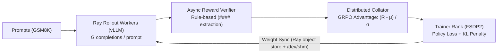
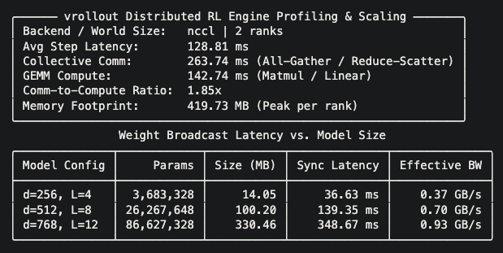
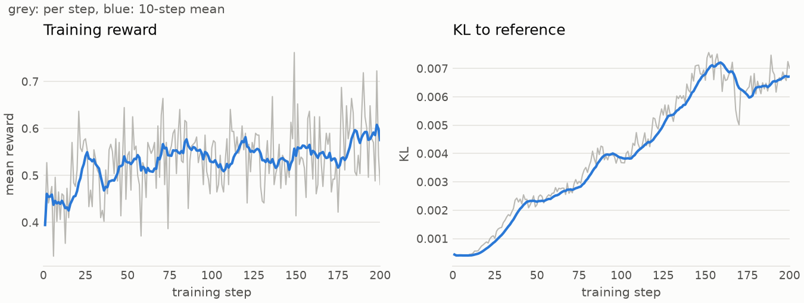

# vRollout: Distributed RL post-training engine

[](https://www.python.org/downloads/)
[](#testing)
[](LICENSE)

A distributed reinforcement learning (RL) rollout generation and training pipeline designed to decouple high-throughput autoregressive inference from policy training.

This repository is an educational reference implementation to study and benchmark inference-training topologies used in LLM post-training.

---

## Overview

Post-training foundation models with reinforcement learning (e.g. PPO, GRPO) introduces severe tension between memory-bound autoregressive token generation and compute-bound model training. Running both within a monolithic loop creates CUDA memory fragmentation and GPU idle bubbles while trainers wait for completion tokens to be available.

`vRollout` resolves this tension by decoupling token generation, reward evaluation, and policy updates into isolated asynchronous actors communicating across bounded queues. After each policy update, rank 0 gathers the full FSDP2 parameters and sends them to the rollout workers through Ray's object store; each worker stages them as safetensors in shared memory (`/dev/shm`) and reloads them in place inside vLLM.



---

## Getting started

Prerequisites: Python 3.12+ and [uv](https://github.com/astral-sh/uv).

```bash
# Clone repository and install dependencies
git clone https://github.com/firnlabs/vrollout.git
cd vrollout
uv sync
```

### Quickstart (CPU)

Run a distributed 2-rank GRPO training loop on GSM8K locally without requiring a GPU cluster:

```bash
# Optional: set UV_LINK_MODE=copy if your environment uses mounted scratch volumes (e.g. Kaggle Notebooks)
uv run torchrun --standalone --nproc_per_node=2 --local-addr 127.0.0.1 \
  -m vrollout.train \
  --backend mock \
  --dataset gsm8k \
  --group-size 4 \
  --num-iterations 3 \
  --eval-every 1
```

### GPU cluster training (vLLM backend)

Train an open-weight policy on a single GPU node using Ray rollout actors backed by vLLM. On a 4-GPU node, the command below trains on GPUs 0-1 and serves vLLM on GPUs 2-3:

```bash
uv run torchrun --standalone --nproc_per_node=2 \
  -m vrollout.train \
  --backend vllm \
  --model-name Qwen/Qwen2.5-0.5B-Instruct \
  --dataset gsm8k \
  --group-size 8 \
  --num-rollout-workers 2 \
  --gpus-per-worker 1.0 \
  --wandb
```

With more than one trainer rank, actor and reference models are sharded per transformer block with FSDP2, and the GRPO loss is normalized by the global token count so the update matches a single-process step on the full batch. A single rank trains unsharded by default; pass `--fsdp` to shard anyway (e.g. to exercise the FSDP2 path on one GPU). `--no-fsdp` is rejected when the world size is greater than 1, since nothing else synchronizes gradients.

Only rank 0 drives rollouts and evaluation; the other ranks wait in a collective until it broadcasts the next batch. `--dist-timeout-minutes` (default 60) bounds that wait, so raise it if one rollout + eval cycle can take longer (e.g. evaluating the full GSM8K test split).

Trainer rank `r` uses the `r`-th visible GPU, and Ray rollout workers are placed only on the GPUs left over. If there are none (e.g. one GPU, or as many trainer ranks as GPUs), vLLM shares the trainers' GPUs, so lower `--gpu-memory-utilization` and use a fractional `--gpus-per-worker`. Training refuses to start if `--num-rollout-workers` x `--gpus-per-worker` cannot fit on the rollout GPUs, since Ray would otherwise wait for resources indefinitely.

### Experiment tracking with Weights & Biases

`vrollout` provides native, zero-overhead experiment tracking on `rank 0` with [Weights & Biases](https://wandb.ai):

```bash
uv run torchrun --standalone --nproc_per_node=4 \
  -m vrollout.train \
  --backend vllm \
  --model-name Qwen/Qwen2.5-0.5B-Instruct \
  --dataset gsm8k \
  --group-size 8 \
  --wandb \
  --wandb-project vrollout \
  --wandb-run-name qwen0.5b-gsm8k-run1
```

- **Run naming**: Runs default to an informative identifier formatted as `{model}-{backend}-{dataset}-G{group_size}-{timestamp}` (e.g. `Qwen2.5-0.5B-Instruct-vllm-gsm8k-G8-20261027_154500`). Use `--wandb-run-name` to supply a custom name.
- **Offline / Local testing**: You can test without an account or internet access by setting `WANDB_MODE=offline`. Metrics will be logged locally to `wandb/` (ignored by git):

  ```bash
  WANDB_MODE=offline uv run torchrun --standalone --nproc_per_node=1 --local-addr 127.0.0.1 \
    -m vrollout.train --backend mock --wandb
  ```

- **Live dashboards & Colab**: Authenticate using `uv run wandb login` or export `WANDB_API_KEY="<key>"`. Tracked metrics include:
  - **Policy metrics**: `loss`, `kl`, `clip_fraction`, `reward_mean`, `eval_reward_mean`, `eval_accuracy_strict` (only answers marked with `\boxed{}`, `####` or a phrase such as "The answer is" count) and `eval_accuracy_lenient` (falls back to the last math expression in the completion), independent of `--strict-format`.
  - **Performance**: `step_time_s` per iteration.
  - **Hardware telemetry**: GPU memory allocation, GPU power draw, temperature, and compute utilization.
  - **Evaluation answers**: `eval_response_length_mean`, `eval_truncation_rate`, and an `eval_samples` table with every eval answer (prompt, extracted and raw ground truth, completion, extracted answer, reward, finish reason, length). Pass `--eval-output-dir <dir>` to also save them as `eval-step-<N>.jsonl`.

### Running the distributed engine benchmark

The following benchmark script profiles PyTorch FSDP2 model sharding, distributed training iterations, and parameter weight broadcasting across ranks (tested on CPU via `gloo` and GPU via `nccl`):

```bash
uv run torchrun --standalone --nproc_per_node=2 --local-addr 127.0.0.1 \
  benchmarks/run_engine_benchmark.py
```

To view all benchmark configuration options (such as `--with-stack`, `--warmup-steps`, and `--trace-dir`):

```bash
uv run python benchmarks/run_engine_benchmark.py --help
```

#### Sample benchmark

Below are the benchmarking results from 2x T4 GPU accelerators in Kaggle Notebooks:



---

## GSM8K results

`Qwen/Qwen2.5-0.5B-Instruct` was trained with synchronous GRPO for 200 steps on 6,400 GSM8K training problems (32 prompts × G = 8 per step, T = 1.0, lr 1e-6), with 2x A40 GPUs (trainer and vLLM rollout worker on separate GPUs).
The untrained model (E0) and the step-200 checkpoint (E1) were evaluated on all 1,319 test problems with greedy decoding and strict scoring.

| Model | Strict accuracy | Lenient accuracy | Truncated |
| --- | --- | --- | --- |
| E0 (untrained) | 0.488 | 0.496 | 5.1% |
| E1 (step 200) | 0.527 | 0.531 | 4.3% |

- **Accuracy**: +3.9 points strict (95% CI ±2.2; 137 problems gained, 86 lost; exact McNemar p = 0.0008).
  E0 matches the 49.6 reported for this model in the Qwen2.5 technical report.
- **Eval noise**: Repeating the greedy eval of the same model in a new vLLM engine flipped the verdict on 8–11% of problems, most likely because vLLM's kernels are not batch-invariant.
  The confidence interval does not include this run-to-run spread.
- **Step time**: The median step took 51.2 s: rollout 17.5 s, training 26.4 s and weight sync 7.2 s.
  In synchronous mode each GPU sits idle while the other works.
- **Temperature bug**: Earlier runs at T = 0.8 collapsed because vLLM and the trainer both scored tokens at T = 1.0, making training silently off-policy.
  PR #72 fixed the mismatch.

### Training curves



Training reward rose from 0.48 to 0.58, mostly in the first 75 steps and the last 25.
KL to the reference model rose from 0.0006 to 0.0066 and was flat over the last 50 steps.
Start and end values are means over the first and last 25 steps.

The setup, analysis and reproduction commands are in the [E0/E1 GRPO GSM8K report](docs/reports/2026-11-06-e0-e1-grpo-gsm8k/e1-report.md).

Earlier runs are in [docs/reports/](docs/reports/).

---

## Directory structure

```text
.
├── benchmarks/
│   ├── run_engine_benchmark.py         # Engine profiling & communication scaling
│   └── run_gpu_benchmark.py            # GPU capability, PCIe/HBM bandwidth & GEMM profiling
├── docs/
│   ├── assets/                         # Documentation screenshots & visual assets
│   └── reports/                        # Empirical evaluation & training reports
├── src/vrollout/
│   ├── async_queue.py                  # Asynchronous queue for reward scoring
│   ├── buffer.py                       # Distributed rollout buffer and batch collation
│   ├── collate.py                      # Sequence batch padding and collation
│   ├── datasets.py                     # GSM8K and synthetic dataset loaders
│   ├── engine.py                       # Distributed RL engine orchestrator
│   ├── gae.py                          # Fused Triton GAE kernel with PyTorch reference
│   ├── generation.py                   # Distributed token generation using Ray
│   ├── grpo.py                         # GRPO loss and advantage calculation
│   ├── pipeline.py                     # Rollout generation and scoring pipeline
│   ├── sync.py                         # Weight broadcasting back to rollout actors
│   ├── train.py                        # Distributed GRPO CLI runner
│   ├── verifiers.py                    # Rule-based math answer verifiers (GSM8K)
│   └── vllm_engine.py                  # vLLM async worker integration
├── tests/
│   ├── unit/                           # Unit tests
│   └── integration/                    # Integration tests
└── pyproject.toml                      # uv-based Python project configuration
```

---

## Testing

Run the complete test suite:

```bash
uv run pytest
```

---

## Contributing

Contributions, feedback, and bug reports are welcome. To contribute:

1. Fork the repository and create a feature branch (e.g. `git checkout -b feat/my-feature`).
2. Verify all tests pass and linting succeeds (`uv run pytest && uv run ruff check`).
3. Submit a pull request describing the rationale, changes made, and invariants preserved.

---

## License

This project is licensed under the Apache License 2.0 - see the [LICENSE](LICENSE) file for details.
