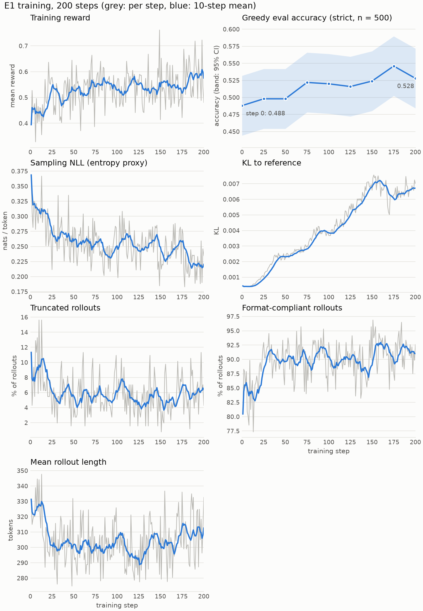
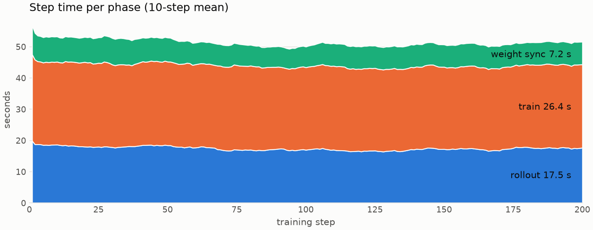

# Sync GRPO on GSM8K with Qwen2.5-0.5B-Instruct

**Date:** November 6, 2026

## Summary

Qwen2.5-0.5B-Instruct was trained with GRPO for 200 steps on 6,400 GSM8K training problems, using vLLM for rollouts on 2× NVIDIA A40 GPUs.
Training was synchronous: each step generated rollouts with the current weights, trained on them, and copied the new weights to vLLM before the next step.
The untrained model (E0) and the step-200 checkpoint (E1) were evaluated on all 1,319 GSM8K test problems with greedy decoding and strict scoring.
Accuracy rose from 0.488 to 0.527 (+3.9 points, 95% CI ±2.2; exact McNemar p = 0.0008).
Evaluating the same model twice flipped the verdict on 8–11% of problems, which means that part of the per-problem change is eval noise.
The median step took 51.2 s: rollout 17.5 s, training 26.4 s and weight sync 7.2 s.
Earlier attempts at temperature 0.8 collapsed because vLLM and the trainer both computed log-probs at temperature 1.0, making training off-policy.
PR #72 fixed the mismatch, and E1 ran at T = 1.0.

## Setup

- Model: [Qwen/Qwen2.5-0.5B-Instruct](https://huggingface.co/Qwen/Qwen2.5-0.5B-Instruct)

- Data: GSM8K
  - Train: first 6,400 training problems in dataset order (32 prompts × 200 steps, each used once)
    - Each problem is used once, so each step's reward is measured on problems the model has not yet been trained on.
    - Dataset order gives every run the same data without a seed.
    - The order is not sorted by difficulty, so problems do not get harder or easier during training.
      - Difficulty is measured as the number of calculation steps in a problem's reference solution.
        GSM8K marks each arithmetic operation in its solutions with a calculator annotation, e.g. `<<16-3-4=9>>`, and counting them gives the step count.
      - The mean step count is 3.1–3.2 in each consecutive block of 1,600 training problems (the last block has 1,073).
  - Eval: first 500 test problems every 25 steps; all 1,319 for E0 and the E1 checkpoints at steps 175 and 200

- Prompt: Qwen2.5's chain-of-thought instruction in the chat template (`--chat-template --prompt-template qwen-boxed`):

  ```text
  {question}
  Please reason step by step, and put your final answer within \boxed{}.
  ```

- GRPO training
  - Seed = 0
  - Group size G = 8
  - Rollout temperature T = 1.0
  - Loss: clipped surrogate (ε = 0.2) plus k3 KL penalty to the reference (β = 0.04), averaged over all completion tokens in the batch
  - One optimizer step per batch of 256 completions, accumulated over micro-batches of 4
    - The "old" policy is the sampler's log-probs, so clipping engages only where vLLM and the trainer disagree (0.27% of tokens at the median step).
  - AdamW: lr 1e-6 (10 linear warmup steps, then constant), weight decay 0.01, gradient norm clipped at 1.0

- Reward: 1 if correct under lenient scoring, else 0
  - Lenient scoring also accepts the last number in the completion, so no marked answer is required.
  - Format was not the bottleneck (86% of rollouts marked their answer at the start), and a strict reward would mix a format objective into a sparse 0/1 signal.

- Hardware and software
  - GPU 0 (A40, 48 GB): trainer, single process; fp32 weights with bf16 autocast; bf16 reference model
  - GPU 1 (A40, 48 GB): vLLM 0.27.1 rollout worker, bf16, eager mode
    - Eager mode (vrollout's default) skips CUDA graph capture and compilation, which shortens startup for eval-only runs and removes one source of sampler/trainer numerical differences.
      Its rollout-time cost was not measured.
  - PyTorch 2.13.0, Transformers 5.15.0, Ray 2.57.0, Python 3.12.3

- Evaluation
  - Greedy decoding (T = 0), 512 max new tokens
  - Strict scoring: only answers marked with `\boxed{}` or an explicit answer phrase count (math-verify); lenient reported alongside
    - Strict scoring avoids counting the last number of a truncated answer as correct by chance.
  - Format-compliant: contains `\boxed{}` or `#### <answer>`
  - Paired comparison: accuracy delta, 95% Wald CI, exact McNemar test

The exact commands are in the [appendix](#appendix-reproducibility).

## Results

### E1 vs E0 accuracy on all 1,319 problems

| Model | Strict | Lenient | Truncated | Format-compliant |
| --- | --- | --- | --- | --- |
| E0 (untrained) | 0.488 | 0.496 | 5.1% | 94.0% |
| E1 (step 200) | 0.527 | 0.531 | 4.3% | 95.4% |

Paired difference in strict accuracy: +3.9 points (95% CI ±2.2; 137 problems gained, 86 lost; exact McNemar p = 0.0008).

E0 matches the published baseline.
The [Qwen2.5 technical report](https://arxiv.org/abs/2412.15115) gives 49.6 on GSM8K for Qwen2.5-0.5B-Instruct (Table 10), against E0's 0.488 strict and 0.496 lenient.
The Qwen2.5 report does not state the prompt or number of examples used for instruction-tuned models.

The run script evaluated two E1 checkpoints on the full test set: the final one (step 200) and the one with the best accuracy on the 500-problem eval (step 175).
The report uses the final checkpoint, which does not depend on the in-training eval.
Step 175 scored 0.526 strict on the full set, about the same as step 200.

Example of a gained problem, index 842 (0-based) of the GSM8K test split (answers shortened):

> While on vacation in Bali, Thea bought a hat from a craftsman worth $70.
> If she gave the craftsman four $20 bills, how much change did she get?
>
> **E0:** "… \(70 - 80 = -10\) … the change Thea got is \(\boxed{-10}\)"
>
> **E1:** "… Change = $80 - $70 = $10.
> Thus, the change Thea received is \(\boxed{10}\) dollars."

Most gains are of this kind: E0 gave a marked but wrong answer in 122 of the 137 gained problems.
Only 15 were E0 answers that were truncated or had no marked answer.

### Eval noise

Greedy decoding in vLLM is not reproducible across engine instances.
The first 500 test problems were evaluated twice for three models: once during the training run (run 1) and once in a separate full-set eval (run 2).
The table counts **flips**, problems whose strict verdict differs between the two runs ([Dutta et al., 2024](https://arxiv.org/abs/2407.09141)).
Positive flips are wrong in run 1 and right in run 2; negative flips are the reverse.

| Model | Accuracy, run 1 | Accuracy, run 2 | Flips (+ / −) | Answer text differs |
| --- | --- | --- | --- | --- |
| E0 | 0.488 | 0.486 | 45, 9.0% (22 / 23) | 311 (62%) |
| E1 step 175 | 0.546 | 0.552 | 55, 11.0% (29 / 26) | 388 (78%) |
| E1 step 200 | 0.528 | 0.558 | 39, 7.8% (27 / 12) | 380 (76%) |

Fixing the sampling seed does not help here, because greedy decoding uses no randomness.
The cause has not been isolated in this experiment, but the likely mechanism is the one described by [He and Thinking Machines Lab (2025)](https://thinkingmachines.ai/blog/defeating-nondeterminism-in-llm-inference/): the inference kernels are not batch-invariant.
Floating-point addition is not associative, so the result of a sum depends on the order of its terms.
The matmul, attention and normalization kernels choose how to split and order their sums based on the batch they run on, and vLLM's continuous batching makes that batch depend on timing: which requests arrive together, and which finish first.
Chunked prefill and prefix caching also change how a prompt's attention is computed.
The same prompt can therefore get slightly different logits from one run to the next, and in bf16 that is enough to swap two near-tied tokens.
After the first swapped token the answer continues from a different prefix and can diverge entirely.
This explains why answer text differs far more often (62–78%) than the verdict flips (8–11%): most divergences reword the solution but reach the same final answer.
The article measures the same effect at larger scale: 1,000 temperature-0 completions of one prompt with Qwen3-235B-A22B gave 80 distinct answers, and batch-invariant kernels made all 1,000 identical.

For E0 and step 175 the flips are balanced, so accuracy barely moved.
For step 200 they were not (27 against 12), and accuracy moved by 3.0 points, close to the +3.9-point gain.
The paired test still finds a gain, but the numbers come from one eval per model.
Their run-to-run spread on all 1,319 problems has not been measured.

E0's 0.488 on the 500-problem eval and its 0.488 on the full set come from different evals and match by coincidence.
On the same 500 problems, the full-set eval scored 0.486, one problem fewer.

### Training curves



Start and end values are means over the first and last 25 steps.

- Training reward rose from 0.48 to 0.58: most of the gain came in the first 75 steps and the last 25, with a plateau in between (row 1, left).
- Greedy eval accuracy on the first 500 test problems rose from 0.488 for the untrained model to 0.528 at step 200 (row 1, right; the band is the 95% CI of each point on its own).
  The peak of 0.546 at step 175 is within noise: on the same 500 problems, step 200 is −1.8 points against step 175 (95% CI ±3.0; exact McNemar p = 0.3), and on the full set the two checkpoints score the same.
- Sampling NLL fell from 0.30 to 0.22 nats/token, fastest in the first and last 25 steps (row 2, left).
  Sampling NLL is the mean negative log-prob of the sampled tokens, as reported by vLLM; it estimates the policy's per-token entropy without an extra forward pass.
- KL to the reference rose from 0.0006 to 0.0066, peaked at 0.0076 at step 152, and was flat over the last 50 steps (row 2, right).
  The ~0.0004 at step 1 is a precision floor (bf16 reference vs bf16-autocast model being trained), not drift.
- Truncated rollouts fell from 8.2% to 5–6% after the first 25 steps (row 3, left).
- Format-compliant rollouts rose from 86% to 92% (row 3, right), while greedy eval compliance was already 94–97%.
- Mean rollout length changed little, from 316 to 310 tokens.
  It fell from about 330 to 300 tokens over the first 25 steps and reached its lowest, about 290 tokens, around step 125 (row 4).

Training reward rose by about 10 points, but greedy accuracy by only 4.
Two differences between them account for most of the gap:

- **Format**: Rollouts gained 6 points of format compliance.
  Greedy answers were already 94% compliant, so there was less to gain.
- **Sampling**: Training reward is measured on samples at T = 1, while evaluation is greedy.
  The falling sampling NLL shows the policy getting sharper, which makes T = 1 samples more like the greedy answer.
  The greedy answer itself changes less.

### Per-problem outcomes

The table below shows outcomes for the 1,319 problems based on whether the baseline (E0) and the trained model (E1) answered each problem correctly (strict scoring):

| Outcome | E0 | E1 | Problems | Share | Reference calculation steps (mean ± SD) |
| --- | --- | --- | --- | --- | --- |
| Both right | ✓ | ✓ | 558 | 42.3% | 2.8 ± 1.1 |
| Gained | ✗ | ✓ | 137 | 10.4% | 3.2 ± 1.3 |
| Lost | ✓ | ✗ | 86 | 6.5% | 3.3 ± 1.3 |
| Both wrong | ✗ | ✗ | 538 | 40.8% | 3.7 ± 1.6 |

Reference calculation steps counts the `<<…>>` calculator annotations in the GSM8K reference solution, a rough proxy for problem difficulty.
The gained and lost problems are about equally hard, and the problems both models miss need the most steps.
These are mostly wrong final answers, not format or length failures: of E1's 538 answers in this group, 57 (11%) were truncated or had no marked answer, and 48 of those were both.
Given the [eval noise](#eval-noise), some of the gained and lost problems would likely change group if the evals were repeated.

## Early training collapse

The first E1 training attempts used the default rollout temperature at the time, T = 0.8, and collapsed, with attempt 1 (lr 1e-5) from about step 15, and attempt 2 (lr 1e-6) from about step 90.
Sampling NLL rose from about 0.2 to as much as 6 nats/token, and truncated rollouts grew to as much as 65%.
Greedy eval accuracy did not reveal the slower collapse.
At lr 1e-6 it reached its best value, 0.538, at step 125, when sampling NLL was already above 2 and about 30% of rollouts were truncated.

The root cause was that vLLM drew tokens from softmax(z / T) but reported log-probs of the raw logits, softmax(z), and the trainer also scored tokens under softmax(z).
The current, old and reference policies in the GRPO loss therefore all described the T = 1 distribution, while the rollouts came from T = 0.8.
The policy gradient was computed as if the samples came from the T = 1 policy, with no correction for the sharper T = 0.8 distribution that actually produced them.
Why this bias pushes the policy toward higher entropy, rather than lower, was not analyzed.
Because both sides made the same error, no metric flagged it.
The importance ratio stayed near 1, clipping barely engaged (at most 1–2% of tokens), and the sampler/trainer log-prob mismatch metric stayed near zero.
Because vLLM reported T = 1 log-probs, the sampling NLL of the collapsed runs scores T = 0.8 samples under the T = 1 policy.
Lower-temperature samples favor likely tokens, so it starts lower than E1's (0.15–0.19 against 0.37); the gap comes from the sampling temperature, not from a different model.
Both runs score tokens under the same T = 1 policy, so the rise to 3–6 nats/token in the collapsed runs is directly comparable to E1's values.

An A/B run at the pre-fix commit (`dc377b3`) confirmed the cause.
Both runs used lr 1e-5 and otherwise identical flags.
At T = 0.8 the run collapsed again (sampling NLL 3.69 by step 25), while at T = 1.0, where the two distributions coincide, sampling NLL stayed between 0.2 and 0.55 over 40 steps.
The T = 1.0 run still lost accuracy (0.498 to 0.396 in 40 steps, with up to 35% of rollouts truncated), so lr 1e-5 is too high for this model even without the bug.
E1 uses lr 1e-6.

| Run | T | lr | Steps | Max sampling NLL | Max truncated | Strict eval accuracy (n = 500) |
| --- | --- | --- | --- | --- | --- | --- |
| Attempt 1 | 0.8 | 1e-5 | 49 | 6.03 (step 34) | 65% | 0.482 → 0.390 (step 25) |
| Attempt 2 | 0.8 | 1e-6 | 140 | 3.56 (step 130) | 47% | 0.480 → 0.538 (step 125) |
| A/B, T = 0.8 | 0.8 | 1e-5 | 25 | 3.74 (step 24) | 43% | 0.478 → 0.454 (step 25) |
| A/B, T = 1.0 | 1.0 | 1e-5 | 40 | 0.55 (step 32) | 35% | 0.498 → 0.396 (step 40) |
| E1 | 1.0 | 1e-6 | 200 | 0.37 (step 1) | 16% | 0.488 → 0.528 (step 200) |

PR #72 fixed the mismatch on both sides.
vLLM now reports log-probs after temperature scaling, and the trainer divides its logits by the rollout temperature for both the model being trained and the reference model.
An integration test checks that sampler and trainer log-probs agree at T = 0.5, 1 and 2.
The rollout temperature is restricted to [0.01, 2.0], where vLLM samples at exactly the requested value, and the default is now T = 1.0.
E1 ran at T = 1.0, where the fix has no effect, so the fix has not yet been tested in a training run at T ≠ 1.

## System performance

The figure below shows the breakdown of step time by phase.

Step time covers rollout, training and weight sync.
The periodic eval and checkpoint saves are excluded.



The median training step took 51.2 s, and the 200 steps took 2.9 hours in total.
Training was the largest phase at 26.4 s (52%), followed by rollout at 17.5 s (34%) and weight sync at 7.2 s (14%).
The labels in the figure are these medians over all 200 steps.

- **Rollout** generated about 78,000 completion tokens per step, at about 4,460 tokens/s.
- **Training** processed the same tokens at about 2,930 tokens/s, using micro-batches of 4, gradient checkpointing and fp32 weights.
- **Weight sync** copies the fp32 weights (about 2 GB) from GPU to CPU and passes them through the Ray object store to the rollout worker.
  The worker writes them to a safetensors file in shared memory, and vLLM reloads its weights from that file.
  None of these steps were profiled separately.

Step time was stable across the run.
It was about 53 s over the first 50 steps, when sync took about 8 s and responses were longer, and 50–51.5 s after that.
Rollout time moved with mean response length, dipping to about 17 s between steps 75 and 125 as responses shortened.

In synchronous mode, GPU 1 sits idle while GPU 0 trains and GPU 0 sits idle while GPU 1 generates.
From the medians, GPU 1 is idle for about two thirds of each step and GPU 0 for about a third.
Overlapping the two phases (asynchronous training) could remove most of that idle time, at the cost of training on rollouts from slightly older weights.

## Limitations

The results come from a single training seed, so they do not show how much the gain would vary between runs.
The confidence interval covers only the sampling of test problems from one eval per model.
As shown in [Eval noise](#eval-noise), repeating the eval of the same checkpoint flipped 8–11% of verdicts and, in one case, moved accuracy by 3 points on 500 problems.
The interval does not include this run-to-run spread.

The 512-token eval budget truncated 5.1% of E0's answers and 4.3% of E1's.
Truncated answers rarely contain a marked final answer, so both accuracies are somewhat lower than an unlimited budget would give, by an amount not measured here.

The run was relatively short, at 6,400 training prompts, each seen once, with KL to the reference ending near 0.007 and training reward rising again over the last 25 steps.
It does not show where accuracy would level off with longer training.
At 0.5B parameters, 41% of test problems (538 of 1,319) are wrong both before and after training, and these need more calculation steps than the problems either model solves.

Evaluation covers GSM8K only, so the report does not show whether training made the model worse at other tasks.
GSM8K is also widely used and may appear in Qwen2.5's training data, which would make the absolute accuracies optimistic; the E0-to-E1 comparison is less affected.

## Possible future work

- **Measure eval noise on the full test set**: Evaluate E0 and the step-200 checkpoint several times each, in separate vLLM engine instances, and report the spread of accuracy and the paired gain across repeats.
- **Make greedy evaluation reproducible**: Find which engine settings cause the nondeterminism (batch composition, prefix caching, chunked prefill), or evaluate with batch-invariant kernels, such as Thinking Machines' [`batch_invariant_ops`](https://github.com/thinking-machines-lab/batch_invariant_ops), which the article runs on top of vLLM.
  The article reports deterministic vLLM at roughly 1.6–2× the default inference time (42–55 s against 26 s for its Qwen3-8B benchmark).
- **Train at T ≠ 1**: Repeat a short run at T = 0.8 to confirm that PR #72 prevents the collapse in training, not only in the log-prob test.
- **Repeat E1 with more seeds**: This is to measure how much the gain varies between training runs.
- **Train longer**: This is to see where accuracy levels off and whether KL keeps growing.
- **Profile weight sync and eager mode**: Measure the parts of the 7.2 s sync (GPU-to-CPU copy, Ray transfer, file write, vLLM reload), and the rollout time with CUDA graphs enabled.
- **Overlap rollout and training (asynchronous mode)**: Remove the idle time each GPU spends waiting for the other.
- **Evaluate on other benchmarks**: e.g. MATH, to check that training does not make the model worse elsewhere.

## Appendix: Reproducibility

Training and evaluation used commit `7d9133b` on a single machine with 2× A40.
The analysis tools came later: `vrollout-compare-evals` from PR #74, and `scripts/plot_training_history.py` and `scripts/report_stats.py` from the PR that adds this report.

The commands below are templates.
Paths such as `/workspace/...` stand for wherever you keep run outputs, and W&B logging (`--wandb`) is optional: only the figures need a training history, and you would export it from your own W&B project.

### Training and evaluation runs

All runs share these flags:

```bash
COMMON=(
  --backend vllm
  --dataset gsm8k
  --model-name Qwen/Qwen2.5-0.5B-Instruct
  --chat-template
  --prompt-template qwen-boxed
  --format-target any
  --max-tokens 512
  --eval-max-tokens 512
  --max-seq-len 1024
  --num-prompts 32
  -G 8
  --num-rollout-workers 1
  --gpus-per-worker 1.0
  --gpu-memory-utilization 0.85
  --num-qualitative-samples 0
  --wandb
)
```

The defaults at this commit supply the rest of the setup: T = 1.0, lr 1e-6, β = 0.04, ε = 0.2, micro-batch size 4, gradient clipping at 1.0, seed 0 and vLLM eager mode.

E0, the untrained model evaluated on all 1,319 test problems:

```bash
python -m vrollout.train "${COMMON[@]}" \
  --num-iterations 0 \
  --eval-every 1 \
  --num-eval-prompts 1319 \
  --eval-output-dir /workspace/eval/e0-full \
  --wandb-run-name e0-full
```

E1 training, 200 steps with a 500-problem eval and a checkpoint every 25 steps:

```bash
python -m vrollout.train "${COMMON[@]}" \
  --num-iterations 200 \
  --lr-warmup-steps 10 \
  --eval-every 25 \
  --num-eval-prompts 500 \
  --eval-output-dir /workspace/eval/e1-t1-lr1e-6-w10 \
  --checkpoint-dir /workspace/checkpoints/e1 \
  --checkpoint-every 25 \
  --wandb-run-name e1-t1-lr1e-6-w10
```

Full-set eval of a checkpoint (shown for step 200; step 175 is the same):

```bash
python -m vrollout.train "${COMMON[@]}" \
  --model-name /workspace/checkpoints/e1/step-200 \
  --num-iterations 0 \
  --eval-every 1 \
  --num-eval-prompts 1319 \
  --eval-output-dir /workspace/eval/e1-full-step-200 \
  --wandb-run-name e1-full-step-200
```

The `--model-name` given after `"${COMMON[@]}"` overrides the base model.

### Analysis

The commands below assume the eval directories above were copied to `eval/` and the training histories saved to `runs/`.

To save a run's history, download it from your W&B project:

```bash
uv run scripts/report_stats.py fetch-history \
  <entity>/<project>/<run-id> \
  -o runs/history-e1-t1-lr1e-6-w10.json
```

Paired comparison of E0 and E1 (the headline numbers and a side-by-side HTML page of every answer):

```bash
uv run vrollout-compare-evals \
  eval/e0-full/eval-step-0.jsonl \
  eval/e1-full-step-200/eval-step-0.jsonl \
  --base-label E0 \
  --candidate-label E1 \
  -o compare-e0-e1-step200.html
```

Figures from the training history:

```bash
uv run --group notebook scripts/plot_training_history.py export \
  runs/history-e1-t1-lr1e-6-w10.json \
  -o e1-history.csv
uv run --group notebook scripts/plot_training_history.py plot \
  e1-history.csv \
  -o e1-training.png \
  --step-time-output e1-step-time.png
```

The other derived numbers come from `scripts/report_stats.py`:

```bash
# per-problem outcomes, failure kinds, lenient accuracy and truncation
uv run scripts/report_stats.py outcomes \
  eval/e0-full/eval-step-0.jsonl \
  eval/e1-full-step-200/eval-step-0.jsonl

# eval noise: the in-training eval against the separate full-set eval
uv run scripts/report_stats.py flips \
  eval/e1-t1-lr1e-6-w10/eval-step-0.jsonl \
  eval/e0-full/eval-step-0.jsonl
uv run scripts/report_stats.py flips \
  eval/e1-t1-lr1e-6-w10/eval-step-200.jsonl \
  eval/e1-full-step-200/eval-step-0.jsonl

# 25-step means and peaks of the training curves; step time and throughput
uv run scripts/report_stats.py curves \
  runs/history-e1-t1-lr1e-6-w10.json
uv run scripts/report_stats.py step-times \
  runs/history-e1-t1-lr1e-6-w10.json

# collapse comparison table, one history per run
uv run scripts/report_stats.py runs \
  runs/history-*.json
```
