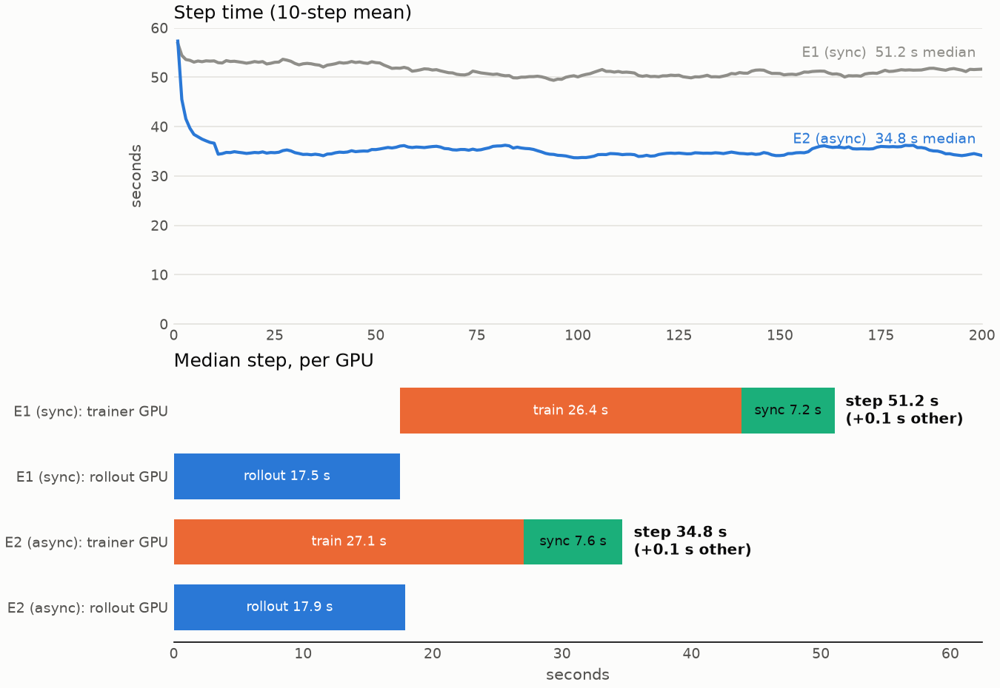
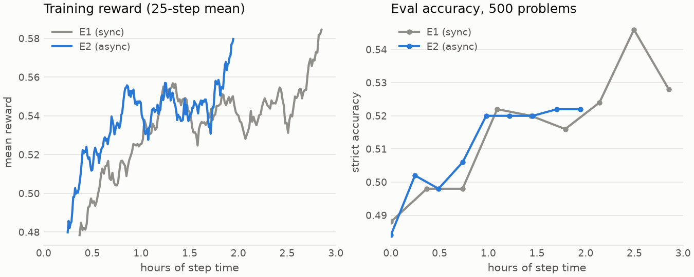
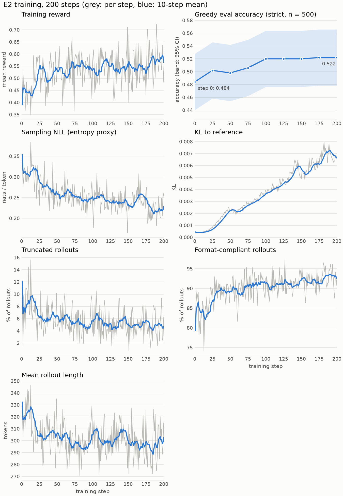

# Async GRPO on GSM8K with Qwen2.5-0.5B-Instruct

**Date:** November 18, 2026

## Summary

Experiment run E2 repeats the [E1 run](../2026-11-06-e0-e1-grpo-gsm8k/e1-report.md) with one change: rollouts for the next step are generated while the current step trains.
Each batch was therefore generated by weights one update older than the weights it trained (staleness 1).
The median step took 34.8 s against E1's 51.2 s (−32%), and the 200 steps took 1.95 hours of step time against 2.85.
On all 1,319 GSM8K test problems, the step-200 checkpoint scored 0.535 strict accuracy against E1's 0.527: +0.8 points (95% CI −1.3 to +3.0; exact McNemar p = 0.5).
Against the untrained model (E0, 0.488), E2 gained +4.7 points (95% CI ±2.3; p = 5.6 × 10⁻⁵), against E1's +3.9.
Training metrics tracked E1 closely, and none showed a cost from training on one-step-stale rollouts.

## Setup

E2 used the [E1 setup](../2026-11-06-e0-e1-grpo-gsm8k/e1-report.md#setup), with the same model, training data, prompt, GRPO hyperparameters, seed and evaluation.
The following table shows the differences:

| | E1 | E2 |
| --- | --- | --- |
| Rollouts | Synchronous: generate, train, then copy weights to vLLM | Asynchronous (`--async-rollouts`): the next batch generates while the current one trains |
| Staleness (weight updates between generating a batch and training on it) | 0 | 0 at step 1, then 1 |
| Commit | `7d9133b` | `ebb5a7f` |
| Machine | 2× A40 48 GB | 2× A40 48 GB (different host machine) |

### Code changes

Asynchronous mode (PR #82):

- While step *k* trains on GPU 0, vLLM generates the batch for step *k* + 1 on GPU 1, using the weights from before step *k*'s update.
- After training, the trainer waits for that batch to finish, then copies its new weights to vLLM.
  vLLM never reloads weights mid-batch, so every batch comes from a single weight version.
- The GRPO loss is unchanged: its old policy π_old is the sampler's log-probs, which in E2 come from the previous weights, so the importance ratio spans one update.
- Evaluation runs after the weight copy, with nothing generating (as in E1).

The code changes between the two commits do not affect synchronous training.
Dependency versions are the same (PyTorch 2.13.0, Transformers 5.15.0, Ray 2.57.0, vLLM 0.27.1, Python 3.12.3).
PR #83 disabled math-verify's parsing timeouts, which cannot run outside the main thread.

## Results

### Speed



*Top: step time of E1 and E2, 10-step trailing mean.
Bottom: each run's median step on each GPU.
In E2, the rollout GPU generates the next batch while the trainer GPU trains and copies weights.
Step time covers rollout, training, weight sync and about 0.1 s of other work, and excludes evals and checkpoint saves.*

| Run | Median step | Rollout | Training | Weight sync | Other | Wait for next batch | Step time, 200 steps |
| --- | --- | --- | --- | --- | --- | --- | --- |
| E1 (sync) | 51.2 s | 17.5 s | 26.4 s | 7.2 s | 0.1 s | — | 2.85 h |
| E2 (async) | 34.8 s | 17.9 s | 27.1 s | 7.6 s | 0.1 s | 0.0 s | 1.95 h |

"Other" is the part of each step outside the three timed phases, such as handing the scored batch to the trainer and computing metrics.
Each column is a median over the 200 steps, so the columns need not add up exactly.
In E1 the step is the sum of the phases: 17.5 + 26.4 + 7.2 + 0.1 = 51.2 s.
In E2, rollout overlaps training but not the weight copy, so the step is max(17.9, 27.1) + 7.6 + 0.1 = 34.8 s.
The trainer never waited for a batch, so rollout is fully hidden.
Only step 1, which has no previous step to overlap with, ran at sync speed (57 s).

Including the periodic eval and checkpoint saves, the 200-step run took 2 h 07 min against E1's 2 h 58 min (−29%).



*Training reward (25-step trailing mean, shown from step 25) and strict accuracy on the 500-problem in-training eval, against hours of step time: the cumulative sum of per-step times, excluding evals and checkpoint saves.*

E2 reaches each level of training reward and eval accuracy earlier than E1, at about the same height.
When E2 finished its 200 steps (1.95 h), E1 was at step 137.
Re-evaluating the same checkpoint on these 500 problems can move accuracy by several points (see [Eval noise](#eval-noise)).

### Accuracy

In this pair of runs, async training did not measurably change accuracy, which was expected.
The final checkpoints of E1 and E2 (step 200) were evaluated on all 1,319 GSM8K test problems with greedy decoding.
Answers were scored strictly: only an answer marked with `\boxed{}` or an explicit answer phrase counts (see [E1 setup](../2026-11-06-e0-e1-grpo-gsm8k/e1-report.md#setup)).
Since both models answered the same problems, the comparison is paired:

| | E2 right | E2 wrong | Total |
| --- | --- | --- | --- |
| **E1 right** | 593 | 102 | 695 |
| **E1 wrong** | 113 | 511 | 624 |
| **Total** | 706 | 613 | 1,319 |

- E1 is right on 695 problems (0.527) and E2 on 706 (0.535).
- The 1,104 problems both models get right or both get wrong do not affect the difference, which comes from the 215 they disagree on: (113 − 102) / 1,319 = +0.8 points.
- An exact McNemar test on the 113-to-102 split gives p = 0.5.
- The 95% confidence interval of the paired difference is (11 ± 1.96 × √(215 − 11² / 1,319)) / 1,319 = −1.3 to +3.0 points.

The interval excludes a loss of more than 1.3 points for E2, and it includes zero, so the data do not show E2 being more accurate.
Both runs improve on the untrained model (E0) by a similar margin.
In the table below, gained counts the problems only the first-named model solves, and lost those only the second-named model solves:

| Comparison | Difference | 95% CI | Gained / lost | Exact McNemar p |
| --- | --- | --- | --- | --- |
| E2 vs E1 | +0.8 points | −1.3 to +3.0 | 113 / 102 | 0.5 |
| E2 vs E0 | +4.7 points | +2.4 to +7.0 | 147 / 85 | 5.6 × 10⁻⁵ |
| E1 vs E0 ([E1 report](../2026-11-06-e0-e1-grpo-gsm8k/e1-report.md#e1-vs-e0-accuracy-on-all-1319-problems)) | +3.9 points | +1.7 to +6.1 | 137 / 86 | 0.0008 |

Both E0 rows use the same E0 eval, so the gap between E2's and E1's gains over E0 (4.7 − 3.9) is the E2 vs E1 difference.

Other properties of the answers:

| Model | Strict accuracy | Lenient accuracy | Truncated | Format-compliant | Mean length |
| --- | --- | --- | --- | --- | --- |
| E0 (untrained) | 0.488 | 0.496 | 5.1% | 94.0% | 309 tokens |
| E1 (sync, step 200) | 0.527 | 0.531 | 4.3% | 95.4% | 304 tokens |
| E2 (async, step 200) | 0.535 | 0.538 | 3.4% | 96.4% | 295 tokens |

Lenient scoring also accepts the last number in an answer, truncated answers hit the 512-token limit, and format-compliant answers contain `\boxed{}` or `#### <answer>`.

The breakdowqn of the problems only one model solves and the other model's fails are as follows:

| Problems | Failed answer | Wrong final answer | Truncated | Finished, no marked answer |
| --- | --- | --- | --- | --- |
| E2 only (113) | E1's | 105 | 6 | 2 |
| E1 only (102) | E2's | 99 | 2 | 1 |
| Net for E2 | | +6 | +4 | +1 |

Most disagreements are between two complete answers with different final values.
Fewer truncated answers account for 4 of E2's net 11 problems.
On the 511 problems both models miss, E2's answers are 464 wrong final answers, 42 truncated and 5 unmarked.

Both runs also have a full-set eval at step 175, the step where E1's 500-problem in-training eval peaked.
There, E2 scored 0.513 against E1's 0.526: −1.3 points (95% CI ±2.1; 94 gained, 111 lost; p = 0.26).
Between steps 175 and 200, E2 rose 2.2 points while E1 stayed flat (0.526 to 0.527).
Both changes are within the run-to-run variation of a single eval (see [Eval noise](#eval-noise)).
Step 200 is the main comparison because it is the final checkpoint, fixed before training, whereas step 175 was chosen from E1's in-training results.

### Staleness and training stability

| Metric (median over 200 steps) | E1 | E2 |
| --- | --- | --- |
| Staleness after step 1 | 0 | 1 (every step) |
| Mismatch KL, KL(π_old ‖ π) | 0.00040 | 0.00039 |
| Mean \|log π − log π_old\| | 0.0089 | 0.0088 |
| Clip fraction | 0.27% | 0.27% |
| Gradient norm | 0.68 | 0.69 |
| Groups with no learning signal | 34% | 31% |

π_old is the sampler's log-prob of each token.
In E1, π_old and π come from the same weights, so the mismatch KL measures only the numerical difference between vLLM and the trainer (bf16 sampler against bf16-autocast trainer).
In E2, π_old comes from the weights one update earlier, so the same metric also includes one optimizer step of policy change.
Both runs show the same value throughout, so at $lr = 1\times10^{-6}$ one update moves the policy less than the sampler/trainer precision gap.
Clipping engaged on 0.27% of tokens in both runs, so the clipped objective treated stale and fresh rollouts the same.

### Training curves



*E2 training metrics per step (grey) and as a 10-step trailing mean (blue).
The eval panel shows strict accuracy on the first 500 test problems, measured during training, with a 95% confidence band for each point.*

The figure smooths over 10 steps to show each curve's shape, while the tables below give means over 25-step windows (steps 1–25, 26–50, …).
A window mean covers a stretch of the curve, so it does not match the blue line at any single step, especially early on, when the metrics change quickly.

The curves follow E1's closely.
In the table below, "start" is the mean over steps 1–25 and "end" the mean over steps 176–200:

| Metric | E1 start → end | E2 start → end |
| --- | --- | --- |
| Training reward | 0.478 → 0.585 | 0.480 → 0.580 |
| Sampling NLL (nats/token) | 0.296 → 0.220 | 0.304 → 0.221 |
| KL to reference | 0.0006 → 0.0066 | 0.0005 → 0.0069 |
| Format-compliant rollouts | 85.6% → 91.5% | 84.9% → 92.9% |

Truncation and rollout length are where the two runs differ most, in 25-step means:

| Steps | Truncated, E1 | Truncated, E2 | Mean length, E1 | Mean length, E2 |
| --- | --- | --- | --- | --- |
| 1–25 | 8.2% | 7.9% | 316 | 316 |
| 26–50 | 5.6% | 6.2% | 302 | 305 |
| 51–75 | 5.5% | 5.7% | 300 | 299 |
| 76–100 | 5.7% | 5.3% | 302 | 299 |
| 101–125 | 5.5% | 5.3% | 296 | 300 |
| 126–150 | 5.3% | 5.3% | 303 | 304 |
| 151–175 | 5.4% | 5.1% | 305 | 297 |
| 176–200 | 6.0% | 4.7% | 310 | 297 |

After step 25, E1's truncation rate stays between 5.3% and 5.7% and rises to 6.0% only in the last window, while E2's falls gradually from 6.2% to 4.7%.
Mean length separates from step 151, when E2's rollouts become 8 to 13 tokens shorter than E1's.
The step-200 greedy eval answers differ the same way: 57 of E1's 1,319 answers were truncated (4.3%, mean 304 tokens), against 45 of E2's (3.4%, mean 295 tokens).
Fewer truncations account for 4 of the 11 problems E2 solves net of E1 (see [Accuracy](#accuracy)).

Shifts of this size also occur within a single run: after step 25, E1's mean length varied by 14 tokens between windows (296 to 310).
E2's final truncation rate is lower than any E1 window, but with one seed per run, a gradual drift in one run and a late rise in the other cannot be attributed to async training.

### Eval noise

As in E1, the first 500 test problems were evaluated twice for each checkpoint: during training (run 1) and in the separate full-set eval (run 2).

| Model | Accuracy, run 1 | Accuracy, run 2 | Flips (+ / −) | Answer text differs |
| --- | --- | --- | --- | --- |
| E2 step 0 (untrained) | 0.484 | 0.486 | 47, 9.4% (24 / 23) | 318 (64%) |
| E2 step 175 | 0.522 | 0.524 | 49, 9.8% (25 / 24) | 372 (74%) |
| E2 step 200 | 0.522 | 0.540 | 45, 9.0% (27 / 18) | 364 (73%) |

Step 0 is the same untrained model in E0, E1 and E2.
The in-training evals of E1 and E2 at step 0 disagree on 42 of 500 verdicts (8.4%), and score 0.488 and 0.484.
The flip rates match E1's 8–11%, so greedy evaluation is no more reproducible in async mode, and no less.

At step 200, both runs' in-training eval scored below the separate eval of the same checkpoint: E1 0.528 against 0.558 (27 positive flips, 12 negative), and E2 0.522 against 0.540 (27 / 18).
At steps 0 and 175 the flips were balanced in both runs.
The two evals differ in how the weights reach vLLM (an in-place reload from shared memory, against loading the saved checkpoint) and in batch composition (500 problems, against 1,319).
Which, if either, matters was not tested, and two cases could be chance.
The comparisons in this report use only separate full-set evals, which treat both runs the same way.

The 500-problem in-training evals showed E2 2.4 points behind E1 at step 175 and 0.6 behind at step 200.
On the full set the same checkpoints were 1.3 behind and 0.8 ahead.
These smaller evals are useful for following a run, not for comparing two runs.

The step-200 checkpoints of E1 and E2 disagree on 215 problems (16.3%), more than the 8–11% of verdicts that re-evaluating one model flips, so the two models do differ on individual problems.
The disagreements go both ways in nearly equal numbers (113 and 102), and on problems of the same difficulty.
Their reference solutions need 3.3 ± 1.4 and 3.2 ± 1.4 calculation steps, against 2.8 ± 1.1 for problems both models solve and 3.7 ± 1.6 for those both miss.
Calculation steps count the `<<…>>` calculator annotations in the GSM8K reference solution, a rough proxy for difficulty.

## System performance

Async removed the trainer GPU's wait for rollouts.
The rollout GPU is now the one that waits: it is idle for about 17 of each 34.8 s (49%), against two thirds of each step in E1.
The step is now bound by training plus weight sync (27.1 + 7.6 s), so generating faster would not shorten it.

Each phase ran slightly slower than in E1:

| Phase | E1 | E2 | Change |
| --- | --- | --- | --- |
| Rollout | 17.5 s (4,460 tokens/s) | 17.9 s (4,288 tokens/s) | −4% throughput |
| Training | 26.4 s (2,929 tokens/s) | 27.1 s (2,845 tokens/s) | −3% throughput |
| Weight sync | 7.2 s | 7.6 s | +5% time |

Both runs generated about 77,000 completion tokens per step.
In E2, rollout and training run at the same time and share the host's CPUs, memory bandwidth and PCIe links, which could explain the slowdown.
The runs also used different machines, so the two causes cannot be separated here.

### Potential speedups

In async mode, a step takes max(rollout, training) + weight sync.
The next batch can generate during training but not during the weight copy: vLLM cannot reload weights while generating, and the batch after that needs the new weights.
In E2, training is the longer phase, so the step is training plus weight sync (27.1 + 7.6 s).

Generating further ahead would not help.
Every rollout finished before training did: the slowest batch took 24.5 s and the fastest training step 25.4 s, and the trainer never waited for a batch after step 1.
A deeper queue of batches would only sit idle.

Weight sync is now 22% of the step, and nothing overlaps it.
About 90% of it happens outside vLLM, i.e. gathering fp32 weights to the CPU, the Ray transfer and the shared-memory file write.
The options for a shorter step all reduce sync or training time, and some require allowing staleness above 1:

| Change | Staleness | Estimated step | Change vs E2 |
| --- | --- | --- | --- |
| Smaller weight sync (bf16 transfer, one CPU copy) | 1 | Not estimated; sync stages not yet timed | — |
| Training without gradient checkpointing | 1 | Not measured | — |
| Copy weights every 2 steps | Up to 2 | 27.1 + 7.6 / 2 ≈ 30.9 s | −11% |
| Copy weights every 4 steps | Up to 4 | 27.1 + 7.6 / 4 ≈ 29.0 s | −17% |
| Copy weights in the background during the next training step | 2 | Between 27.1 and 34.7 s, depending on the GPU-to-CPU copy | Up to −22% |
| No weight sync (lower bound) | — | 27.1 s | −22% |

The estimates use E2's median phase times, leave out the 0.1 s of other work, and assume the phase times stay the same.
Gradient checkpointing recomputes each layer's forward pass during the backward pass, which typically adds about a third to training compute, and a 0.5B model with micro-batches of 4 may fit on a 48 GB GPU without it.
The first two rows keep staleness at 1, so they speed up training without changing what it computes.
The others trade a larger gap between sampler and trainer for speed; how much accuracy that costs was not tested here (see [Limitations](#limitations)).

For staleness 1, [Asynchronous RLHF](https://arxiv.org/abs/2410.18252) (Noukhovitch et al., 2025) found the same as E2: training on completions from the previous step matched synchronous training on GSM8K with a 1B model (52.6% vs 52.2%, Table 2).

More staleness used for deeper lookahead pays off only when rollout is the slower phase, for example with longer completions, larger groups, or training split across more GPUs.
In that case, having several batches in flight (possibly on several vLLM engines) keep the trainer busy.

## Limitations

Each condition has one training seed, so the comparison does not show how much either run would vary if repeated.
E1 and E2 differ by 0.8 points, while two evals of E1's step-200 checkpoint on the same 500 problems differed by 3.0, so a repeat could reorder them.
The confidence intervals cover only the sampling of test problems, from one eval per checkpoint.

The two runs used different machines of the same type, so small differences in phase times may come from the hardware rather than from async training.

Staleness was fixed at 1 and the learning rate at $1\times10^{-6}$.
The result does not show what happens with more staleness or faster learning, where one update could move the policy more than the sampler/trainer precision gap.

The speedup depends on the phase balance: E2 was bound by training plus sync, and rollout was only 17.9 s of it.
A setup where rollout dominates would gain more from overlap; one with longer sync would gain less.

The other limitations of E1 apply unchanged: GSM8K only, a 512-token eval budget (3.4% of E2's answers truncated), a short run, and possible GSM8K contamination of Qwen2.5's training data.

## Possible future work

- **Shorten weight sync**: Cast weights to bf16 before the transfer (half the bytes), drop the second CPU copy, and time each stage.
  This shortens every step without adding staleness.
- **Benchmark training without gradient checkpointing**: Measure the training phase without it and with larger micro-batches, which may fit in 48 GB for a 0.5B model.
- **Find the in-training eval gap**: The in-training eval reuses a vLLM engine whose prefix cache survives each in-place weight reload, so it may reuse values computed with older weights.
  To test this, reload the step-200 weights into an engine that has already run the eval, and compare its accuracy with and without `reset_prefix_cache()` against a fresh load of the checkpoint.
- **Repeat E1 and E2 with more seeds**: This is to measure the run-to-run spread, which bounds what one E1/E2 pair can show.
- **Sync weights less often or in the background**: Copying weights every 2 or 4 steps, or overlapping the copy with training, would allow staleness up to 2–4.
  A run with each would show where the mismatch KL, clip fraction and accuracy start to change; a higher learning rate would reach that point sooner.
- **Use a second trainer GPU**: With FSDP2 over two trainer GPUs, rollout would become the slower phase.
  If training time halved, the step would be max(17.9, 27.1 / 2) + 7.6 ≈ 25.5 s; communication between the trainer GPUs makes that a lower bound.

## Appendix: Reproducibility

Training and evaluation used commit `ebb5a7f` on a single machine with 2× A40.
`scripts/plot_sync_async.py` and the `--run-label` option of `scripts/plot_training_history.py` come from the PR that adds this report.

### Training and evaluation runs

The commands below are templates, as in the [E1 report](../2026-11-06-e0-e1-grpo-gsm8k/e1-report.md#appendix-reproducibility), and use its `COMMON` flags.
The runs were launched with `torchrun --standalone --nproc_per_node=1 -m vrollout.train`, which `python -m vrollout.train` stands for below.

Smoke check, 5 steps.
Before the full run started, the smoke run's W&B history had to show staleness 0 then 1, a median wait for the next batch under 5 s, and steps faster than E1's 51.2 s.
It passed with 34.7 s steps and no wait.

```bash
python -m vrollout.train "${COMMON[@]}" \
  --num-iterations 5 \
  --lr-warmup-steps 10 \
  --eval-every 5 \
  --num-eval-prompts 32 \
  --eval-output-dir /workspace/e2/eval/e2-smoke \
  --checkpoint-dir /workspace/e2/checkpoints/e2-smoke \
  --wandb-run-name e2-smoke \
  --async-rollouts
```

E2 training, identical to E1's command apart from `--async-rollouts`, the run name and the output paths:

```bash
python -m vrollout.train "${COMMON[@]}" \
  --num-iterations 200 \
  --lr-warmup-steps 10 \
  --eval-every 25 \
  --num-eval-prompts 500 \
  --eval-output-dir /workspace/e2/eval/e2-async-t1-lr1e-6-w10 \
  --checkpoint-dir /workspace/e2/checkpoints/e2 \
  --checkpoint-every 25 \
  --wandb-run-name e2-async-t1-lr1e-6-w10 \
  --async-rollouts
```

Full-set eval of a checkpoint (shown for step 200; step 175 is the same):

```bash
python -m vrollout.train "${COMMON[@]}" \
  --model-name /workspace/e2/checkpoints/e2/step-200 \
  --num-iterations 0 \
  --eval-every 1 \
  --num-eval-prompts 1319 \
  --eval-output-dir /workspace/e2/eval/e2-full-step-200 \
  --wandb-run-name e2-full-step-200
```

### Analysis

The commands below assume the E1 and E2 eval directories were copied to `eval/` and the training histories saved to `runs/`, as in the E1 report.

Paired comparisons (E2 against E1 and against E0, at step 200; step 175 is the same):

```bash
uv run scripts/report_stats.py outcomes \
  eval/e1-full-step-200/eval-step-0.jsonl \
  eval/e2-full-step-200/eval-step-0.jsonl
uv run scripts/report_stats.py outcomes \
  eval/e0-full/eval-step-0.jsonl \
  eval/e2-full-step-200/eval-step-0.jsonl
```

Side-by-side HTML page of every E1 and E2 answer:

```bash
uv run vrollout-compare-evals \
  eval/e1-full-step-200/eval-step-0.jsonl \
  eval/e2-full-step-200/eval-step-0.jsonl \
  --base-label E1 \
  --candidate-label E2 \
  -o compare-e1-e2-step200.html
```

Eval noise (the in-training eval against the separate full-set eval):

```bash
uv run scripts/report_stats.py flips \
  eval/e2-async-t1-lr1e-6-w10/eval-step-200.jsonl \
  eval/e2-full-step-200/eval-step-0.jsonl
```

Step times, curves and figures:

```bash
uv run scripts/report_stats.py step-times runs/history-e2-async-t1-lr1e-6-w10.json
uv run scripts/report_stats.py curves runs/history-e2-async-t1-lr1e-6-w10.json

E2=docs/reports/2026-11-18-e2-async-grpo-gsm8k
uv run --group notebook scripts/plot_training_history.py export \
  runs/history-e2-async-t1-lr1e-6-w10.json \
  -o $E2/e2-history.csv
uv run --group notebook scripts/plot_training_history.py plot \
  $E2/e2-history.csv \
  -o $E2/e2-training.png \
  --run-label E2
uv run --group notebook scripts/plot_sync_async.py \
  docs/reports/2026-11-06-e0-e1-grpo-gsm8k/e1-history.csv \
  $E2/e2-history.csv \
  --step-time-output $E2/e1-e2-step-time.png \
  --wall-clock-output $E2/e1-e2-wall-clock.png
```
